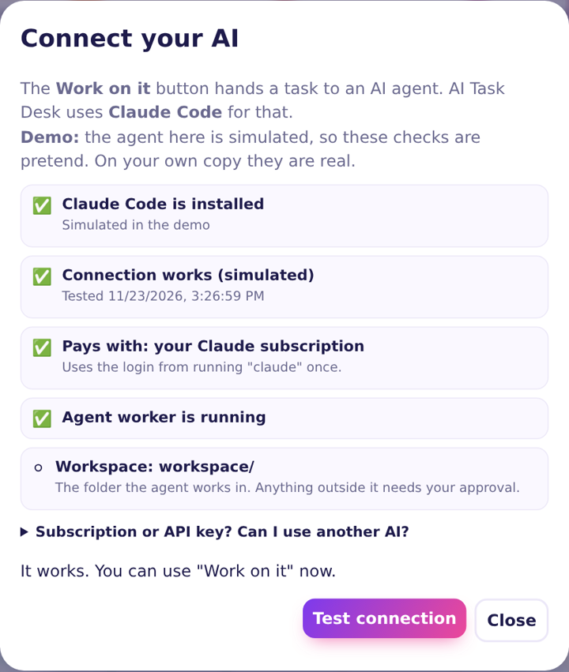
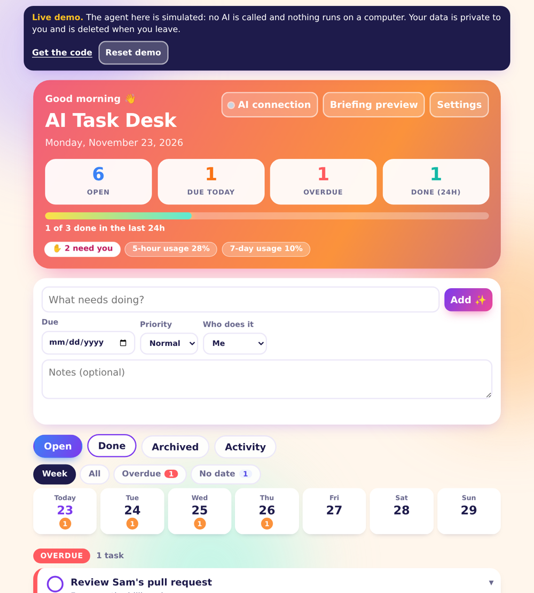
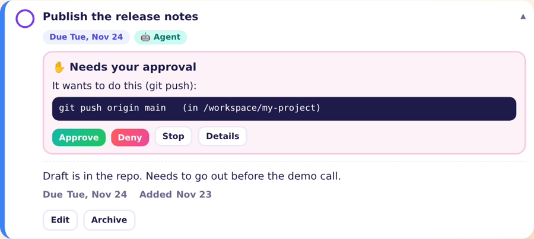

<div align="center">


# AI Task Desk

**A to-do list where you can hand tasks to an AI agent.**<br>
It does the work in a sandbox folder, asks when it needs a decision, stops before anything risky, and lets you undo its file changes.

[](https://github.com/JackB2003/ai-task-desk/actions/workflows/ci.yml)
[](LICENSE)
[](https://nodejs.org)
[](package.json)
[](https://code.claude.com/docs/en/overview)

[**Live demo**](https://jackhost.shop/ai-task-desk/) &nbsp;·&nbsp; [Quick start](#quick-start) &nbsp;·&nbsp; [Connect your AI](#connect-your-ai) &nbsp;·&nbsp; [How it works](#how-it-works) &nbsp;·&nbsp; [Safety](#safety) &nbsp;·&nbsp; [FAQ](#faq)

<br>


<sub>The live demo uses a simulated agent, so you can try everything without installing anything or using an AI.</sub>

</div>

<br>

## Features

- **Hand off tasks.** Mark a task **Agent**, press **Work on it**, and an AI agent does it while you do something else.
- **It asks, it does not guess.** When the agent needs a decision it stops and asks you. Answer, and it carries on.
- **Approval before anything risky.** `git push`, deleting files, sending data out, email, deploys and more are blocked until you say yes. [See the full list.](#safety)
- **Stays in its lane.** The agent works inside one workspace folder. Reaching outside it needs your approval.
- **One-click undo.** Every file the agent edits is backed up first. Undo puts everything back.
- **Phone alerts (optional).** Telegram messages when the agent needs you, plus a daily briefing of what is due.
- **Plan-usage guard.** Warns you at 80% and 90% of your Claude plan, and pauses new runs at 90%.
- **Runs on your machine.** Your tasks stay in a local SQLite file. Nothing is sent anywhere except to the AI that does the work.
- **Tiny.** Plain Node.js, no npm dependencies, no build step.

## Quick start

### Requirements

| You need | Why | Cost |
| --- | --- | --- |
| **[Node.js](https://nodejs.org) 22.13 or newer** | Runs the app (it uses Node's built-in SQLite) | Free |
| **[Claude Code](https://code.claude.com/docs/en/overview)** | This is the AI agent that does the work | A Claude **subscription** (Pro or Max) **or** an Anthropic **API key** |
| macOS or Linux (Windows: use WSL) | The agent runs shell commands | Free |
| A Telegram bot token | *Optional.* Phone alerts and the daily briefing | Free |

> [!NOTE]
> The task list works without Claude Code. Only the **Work on it** button needs it, and the app tells you clearly when it is not connected. See [Connect your AI](#connect-your-ai).

### Install

```bash
git clone https://github.com/JackB2003/ai-task-desk.git
cd ai-task-desk
npm run setup     # a 2-minute guided setup
npm start         # then open http://localhost:3025
```

`npm run setup` walks you through it and checks each step:

1. Checks your Node version.
2. Looks for Claude Code and helps you connect it ([details below](#connect-your-ai)).
3. Sets your password.
4. Asks for your time zone and the agent's workspace folder.
5. Optionally connects Telegram.

Run `npm run doctor` at any time to see what is working and what is not.

## Connect your AI

The agent is **Claude Code**, a program you install separately. AI Task Desk starts it for each task. You choose how it is paid for.



**In the app:** press **AI connection** at the top of the page. It shows, in plain language:

- whether Claude Code is installed,
- whether a test request works,
- how the agent is paid for (subscription or API key),
- whether the agent worker is running,
- and exactly what to do next if something is missing.

If the AI is not connected, a banner says so, and pressing **Work on it** opens this screen instead of failing.

### Pick how it is paid for

| | **Claude subscription** (default) | **Anthropic API key** |
| --- | --- | --- |
| **What it is** | Your Claude Pro or Max plan | Your own key from the [Anthropic Console](https://console.anthropic.com) |
| **You pay** | Your normal plan price. Runs use your plan's allowance | Per use, billed by Anthropic |
| **Set up** | Run `claude` once in a terminal and log in | Choose "API key" in `npm run setup`, or set `AGENT_AUTH=api` and `ANTHROPIC_API_KEY` in `.env` |
| **Good for** | Most people | Heavy use, teams, or no subscription |

### Connect it in three steps

1. **Install Claude Code:** follow [the official instructions](https://code.claude.com/docs/en/overview).
2. **Log in:** run `claude` in a terminal and sign in with your Claude account (skip this if you use an API key).
3. **Test it:** run `npm run setup`, or open **AI connection** in the app and press **Test connection**. It sends one tiny request (about 500 tokens) to prove it works.

<details>
<summary><b>Troubleshooting</b></summary>

<br>

| What you see | What to do |
| --- | --- |
| "Claude Code was not found" | Install it (step 1). If it is installed somewhere unusual, set `CLAUDE_BIN=/full/path/to/claude` in `.env` |
| The test fails with "not logged in" | Run `claude` in a terminal and log in, then test again |
| API key mode says the key is missing | Run `npm run setup` again, or add `ANTHROPIC_API_KEY=...` to `.env`, then restart |
| "Agent worker is not running" | Start everything with `npm start` (it runs the web page and the worker together) |
| A run stops with "plan limit reached" | Your Claude plan is used up for now. The run resumes by itself when the window resets |

Still stuck? Run `npm run doctor` and include the output in a [bug report](https://github.com/JackB2003/ai-task-desk/issues/new?template=bug_report.md). Remove any keys first.

</details>

> [!IMPORTANT]
> **Only Claude is supported today.** Other providers (ChatGPT, Gemini, local models) are not supported yet. Adding one means writing a new agent worker plus rebuilding the safety layer around it. See the [roadmap](#roadmap).

Your key or login never goes into the web page. It stays on your machine, in your environment or in the `.env` file (readable only by you, and ignored by git).

## How it works



1. **Add tasks** and choose who does them: **Me** or **Agent**.
2. **Press Work on it** on an agent task. It joins the queue and runs one at a time (30 minute limit by default).
3. **The agent finishes** with one of these:

   | Result | What it means | What you do |
   | --- | --- | --- |
   | ✅ **Done** | Finished and checked. The task is ticked off for you | Nothing. Open **Details** to see what it did |
   | 🟡 **Partly done** | It did some of it and says what is left | Read the summary, then run it again or take over |
   | ✋ **Needs you** | It has a question | Type your answer. It carries on |
   | 🔒 **Needs approval** | It wants to do something risky | **Approve** or **Deny** that one action |
   | 🚧 **Blocked** | It cannot continue (for example it needs root) | Do what it asks, or stop the run |

4. **Undo** any run's file changes with one click, from **Details**.



### Under the hood

```
 browser ──► server.js ──► SQLite (data/desk.db) ◄── worker.js ──► claude -p ...  (one run at a time)
                                                         │                │
                                                         │      agent/guard.js checks every tool call
                                                         └──► Telegram (optional)
```

| File | What it does |
| --- | --- |
| `server.js` | The web page and its JSON API |
| `worker.js` | Runs the agent through the Claude Code CLI and records what happened |
| `agent/guard.js` | The rule checker that runs before every action the agent takes |
| `agent/rulebook.md` | The instructions the agent always follows |
| `aicheck.js` | Checks that Claude Code is installed and working (used by setup and the AI connection screen) |
| `demo.js` | The scripted, safe version used for public demos |
| `setup.js` | The guided setup and `npm run doctor` |

## Safety

Claude Code runs [`agent/guard.js`](agent/guard.js) before **every** tool call the agent makes.

| The rule checker... | Examples |
| --- | --- |
| **Stops and asks you first** | `git push`, `git reset --hard`, deleting files, `curl -d` (sending data out), email, `ssh` / `rsync` / deploy tools, cloud and payment CLIs, database writes, killing processes, scheduled jobs, reading secrets from the environment |
| **Protects secrets** | `.env` files, SSH keys, cloud credentials, tokens |
| **Keeps the agent in its workspace** | Reading or writing outside the workspace folder needs your approval, including through `~` and `$HOME` |
| **Refuses anything that needs root** | `sudo`, system services, package managers |
| **Protects the app itself** | The agent cannot edit this app's code, rulebook or database |
| **Backs up every edit** | So **Undo** works. (Changes made by build tools or scripts are not tracked) |
| **Fails closed** | If the checker itself breaks, the action is denied |

An approval covers **one action only**. Approving `git push origin main` does not approve `git push origin other`.

> [!WARNING]
> **This is a safety net, not a sandbox.** The agent can run shell commands as *you*. The rule checker catches the common risky patterns, but a pattern list cannot catch everything, and a determined or confused agent could find a way around it.
>
> - Run it as a normal user, **never as root**.
> - Keep sensitive files out of reach.
> - If you hand it tasks you do not fully trust, run it in a container or a separate user account.
> - Read [`agent/guard.js`](agent/guard.js). It is short.

Found a way around the rules? Please [report it privately](SECURITY.md).

## Telegram alerts

Optional. Set it up in `npm run setup`, or later in **Settings**. You need a bot token from [@BotFather](https://t.me/BotFather) (send `/newbot`). You then get:

- a message when a run needs you, finishes, or hits a problem,
- a warning at 80% and 90% of your Claude plan usage,
- an optional morning briefing of what is due.

## Configuration

Everything is optional. Copy [`.env.example`](.env.example) to `.env`, or let `npm run setup` write it.

| Setting | What it does | Default |
| --- | --- | --- |
| `PORT`, `HOST` | Where it listens | `3025`, `127.0.0.1` (this machine only) |
| `TIMEZONE` | For "due today" and the briefing | Your system's |
| `DISPLAY_NAME` | Greeting on the page | none |
| `CLAUDE_BIN` | Path to the Claude Code program | `claude` |
| `AGENT_AUTH` | `subscription` or `api` | `subscription` |
| `ANTHROPIC_API_KEY` | Your key, when `AGENT_AUTH=api` | none |
| `AGENT_WORKSPACE` | The folder the agent works in | `./workspace` |
| `AGENT_ADD_DIRS` | Extra folders the agent may use without asking | none |
| `AGENT_MODEL` | Which Claude model to use | Claude Code's default |
| `RUN_TIMEOUT_MS` | Longest a single run may take | 30 minutes |
| `MAX_TURNS` | Most steps a single run may take | 80 |
| `USAGE_PING` | `1` to check plan usage every 15 minutes (costs a few hundred tokens each time) | off |
| `DATA_DIR` | Where the database and run history live | `./data` |

## Run it on a server

It listens on `127.0.0.1` by default. To reach it from elsewhere, put it behind a reverse proxy with **HTTPS** (nginx, Caddy) and set `TRUST_PROXY=1`, plus `COOKIE_PATH` and `PUBLIC_URL` if it lives under a sub-path. There is one password (throttled after failed attempts).

> [!CAUTION]
> Do not expose the agent to the internet without HTTPS and a strong password. Anyone who gets in can ask the agent to run commands.

Example [nginx](deploy/nginx.conf.example) and [pm2](deploy/ecosystem.config.js.example) configs are in [`deploy/`](deploy).

## Run your own public demo

`DEMO=1 npm run web` starts a version that is safe to publish, like the [live demo](https://jackhost.shop/ai-task-desk/):

- every visitor gets a **private, in-memory copy** with sample tasks,
- the "agent" is a **script** that plays out a believable run: finishing, asking a question, asking for approval,
- **no AI is called, no command runs, nothing is written to disk**,
- uploads, Telegram and passwords are off,
- sessions, request rates, tasks and runs are capped, and idle data is deleted after 45 minutes.

Details and limits are in [`docs/demo-mode.md`](docs/demo-mode.md).

## FAQ

<details>
<summary><b>Do I need an AI subscription to try it?</b></summary>

<br>

No. Try the [live demo](https://jackhost.shop/ai-task-desk/) (simulated agent), or run `npm run demo` locally. To use the real agent on your own tasks you need Claude Code with either a Claude subscription or an Anthropic API key.

</details>

<details>
<summary><b>Can I use ChatGPT, Gemini or a local model?</b></summary>

<br>

Not yet. The agent is Claude Code. Supporting another provider means a new agent worker and a rebuilt safety layer, so it is a project of its own. See the [roadmap](#roadmap).

</details>

<details>
<summary><b>Subscription or API key: which should I choose?</b></summary>

<br>

If you already pay for Claude Pro or Max, use the subscription. It needs no extra billing. Choose an API key if you do not have a plan, want pay-per-use billing, or run it for a team. Agent runs can be long, so keep an eye on your plan limits or API spend.

</details>

<details>
<summary><b>Where is my data?</b></summary>

<br>

In `data/` on your machine: a SQLite file and the history of each run. The only thing that leaves your machine is what the agent sends to the AI to do the work, plus Telegram messages if you turn them on.

</details>

<details>
<summary><b>Is it safe to let an AI run commands?</b></summary>

<br>

It is as safe as the rules, the workspace, and the account you run it under. Read the [Safety](#safety) section, run it as a normal user, and use a container for anything you do not trust. The approval step means nothing risky happens without you saying yes.

</details>

<details>
<summary><b>Does it work on Windows?</b></summary>

<br>

Use WSL (Windows Subsystem for Linux). The agent runs shell commands and manages process groups, which need a Unix-like system.

</details>

## Development

```bash
npm test       # 35 tests, no install step, never calls an AI
npm run demo   # the page with fake data and a simulated agent
```

The tests start the real server on scratch ports and use a fake `claude` program. They cover the web API, the login and first-run flow, every approval rule in the rule checker, the AI connection screen, and the demo's isolation and limits.

```
server.js  worker.js  start.js  setup.js        the programs
aicheck.js  agentlib.js  attach.js  config.js    shared code
db.js  auth.js  demo.js
agent/     guard.js, rulebook.md, schema.json
public/    the web page (index.html, app.js, style.css)
test/      automated tests
deploy/    example nginx and pm2 configs
docs/      demo mode notes and images
```

Contributions are welcome. Please read [CONTRIBUTING.md](CONTRIBUTING.md) first.

## Roadmap

Ideas, not promises:

- [ ] Support for other AI providers
- [ ] Recurring tasks
- [ ] Run several agent tasks at once
- [ ] Container mode: run the agent in a Docker sandbox by default
- [ ] Task attachments from the demo (currently switched off there)

## License

[MIT](LICENSE) © Jack Bonner
